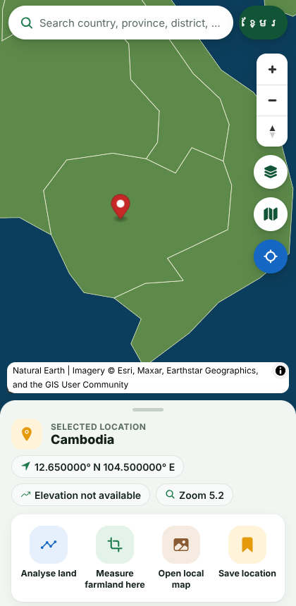
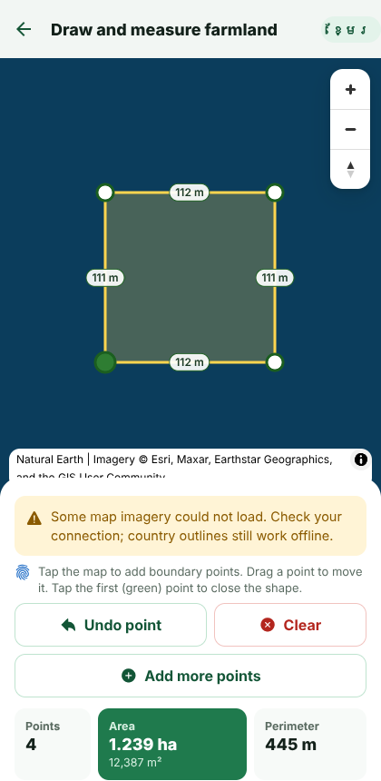
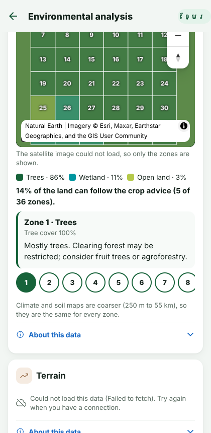
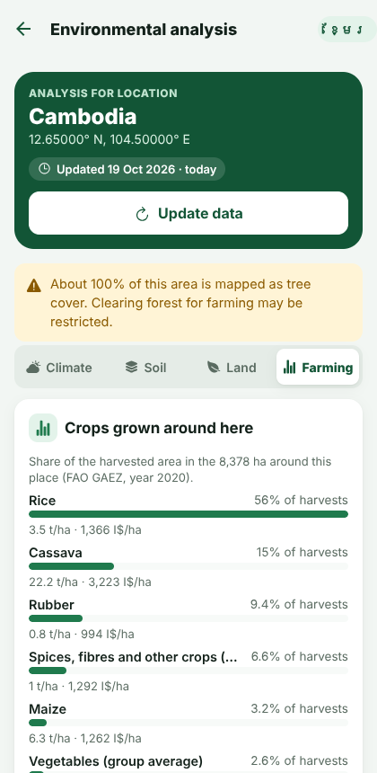
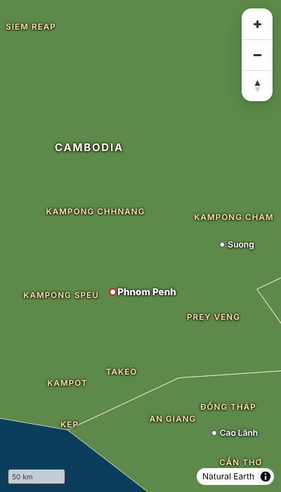
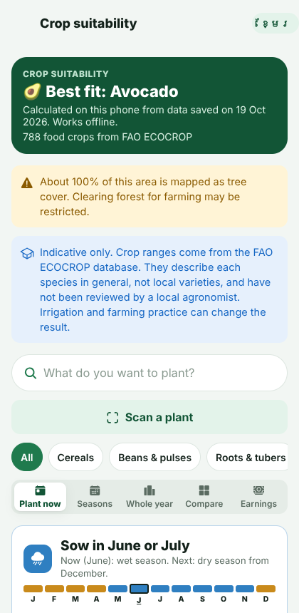
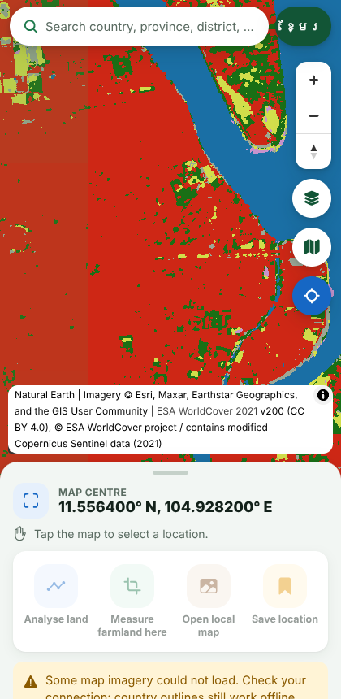

# Farm Adaptation

An Expo (React Native + TypeScript) app for picking a farm location on an interactive 3D globe, getting the user's position with explicit consent, measuring farmland boundaries, and analysing a place's climate, terrain and land cover, plus the farmer's own soil test, to compare crop suitability. Everything is stored offline in SQLite. Khmer and English.

Built for the **NASA Space Apps Challenge 2026**. Every outside source is free and openly licensed or public domain, and all are cited in [Sources and credits](#sources-and-credits) and in the app. The app's own code is under the [Apache License 2.0](LICENSE).

- **Phase 1:** globe, GPS location, search, parcel drawing and measurement, offline storage.
- **Phase 2:** environmental analysis from open data and an ECOCROP-style crop suitability comparison. See [Environmental analysis](#environmental-analysis-phase-2).
- **Phase 3:** crop advice only where land cover shows farmland, season-by-season crop checks with sowing months, and a live land-cover map layer.

| Globe, Cambodia shortcut | Draw and measure |
| --- | --- |
|  |  |

The screenshots come from the automated test browser, which has no access to imagery servers. That is why only the bundled country outlines appear and the "imagery could not load" notice is shown. On a connected phone the satellite imagery fills the map.

## What works now (and how it was tested)

| Feature | Status | Tested by |
| --- | --- | --- |
| 3D globe: drag/swipe to rotate, pinch/wheel/buttons to zoom, tap to select | Done | `scripts/test-map.mjs` (mouse and touch in Chromium) |
| Smooth fly from globe to a local view; globe ⇄ flat map toggle | Done | `test-map.mjs`, `test-app-web.mjs` |
| "Go to Cambodia" shortcut; the app never assumes the user is in Cambodia | Done | `test-app-web.mjs` |
| Lat/lng, zoom, elevation of the selected point (from a terrain model) | Done | `test-map.mjs` (Terrarium decoding) |
| Search: places (online), countries and saved places (offline), typed coordinates | Done | `src/search/__tests__`, `test-app-web.mjs` |
| "My Location": explain → ask permission → one GPS fix → accuracy → marker → fly → save as farm start | Done | `src/location/__tests__`, `test-app-web.mjs` |
| Denied, permanently denied, services off, GPS unavailable, low accuracy, approximate permission, timeout + retry, offline hint | Done | `src/location/__tests__` (all cases), `test-app-web.mjs` (denied, low accuracy) |
| Draw a parcel: tap points, drag to correct, close, undo, clear | Done | `test-map.mjs` (mouse + touch), `test-app-web.mjs` |
| Area (m², ha), perimeter, side lengths; geodesic on WGS84 | Done | `src/geo/__tests__` (against closed-form ellipsoid formulas) |
| Save, list, open, edit, delete parcels and places in SQLite; works offline | Done | `src/db/__tests__` (real SQLite via sql.js), `test-app-web.mjs` (save, reload, edit) |
| Layers: Sentinel-2 cloudless satellite (default, open licence), outline-only, terrain shading, borders | Done | `test-map.mjs` (tile URLs requested and layer shown) |
| Environmental analysis for a point or a saved parcel: rainfall (monthly and year by year), temperature, sunlight, elevation and slope, land cover; soil from the farmer's own test | Done | `src/env/__tests__` (parsers, raster reader, orchestration), `test-app-web.mjs` (screen, with synthetic API responses) |
| Every indicator shows source, provider, period, resolution, retrieval date, age, confidence, limitations and licence | Done | `test-app-web.mjs` |
| Land cover (ESA WorldCover) and elevation/slope (AWS Terrain Tiles) read straight from cloud GeoTIFFs | Done | `npm run test:live` against the **real files** (Phnom Penh, a parcel south of it, Everest, open ocean) |
| Climate (NASA POWER) | Done, **not yet run against the live services** (blocked from the build machine) | Parsers tested on responses shaped like the documented APIs |
| Analyses, crop profiles and recommendations saved in SQLite; crop scores recalculated offline; stale-data warning | Done | `src/db/__tests__/envRepository.test.ts`, `test-app-web.mjs` (scores computed while offline) |
| Crop suitability: ranking with limiting factor and per-factor ranges, plus a comparison table | Done | `src/env/__tests__`, `test-app-web.mjs` |
| All 788 food crops, fruits and vegetables in FAO ECOCROP, with a search bar (English, Khmer, scientific or ECOCROP local names), category filters and a sowing calendar per crop | Done | `src/env/__tests__` (catalogue values, search), `test-app-web.mjs` (searching "rice", "okra", "bhindi") |
| No crop advice unless land cover shows farmland (not water, built-up, snow, mangrove, open sea, or land cover that failed to load) | Done | `src/env/__tests__`, `src/db/__tests__`, `test-app-web.mjs` (blocked when land cover can't load) |
| Seasons (wet/dry from monthly rain in the tropics, four seasons elsewhere) and each crop's best sowing month per season, with and without irrigation | Done | `src/env/__tests__` (synthetic climates), `test-app-web.mjs` |
| Land-cover **map layer** (ESA WorldCover, from zoom 7) | Done | `npm run test:live` and `test-app-web.mjs` read the **real files** (Phnom Penh shows as built-up); `test-map.mjs` (tile drawing) |
| Rainfall, soil and sunlight **map layers** | **Not yet.** Listed as unavailable in the layer picker; the values are on the analysis screen | n/a |
| Khmer/English switch, including dates, units, country names and Cambodian place names | Done | `test-app-web.mjs` (Khmer interface test) |
| **Land zones**: the parcel (or a 400 m square around a point) split into up to 6 × 6 zones, each classed from its own land cover and slope (cropland, open, low spot, wetland, steep, trees, water, built-up) with advice per zone | Done | `src/env/__tests__` (classification), `npm run test:live` and `test-app-web.mjs` (real WorldCover files) |
| **Crops grown nearby, prices and farm economy**: FAO GAEZ v5 harvested area and yield in the ~10 km cell around the place, value per hectare at FAO international prices, and country totals for 204 countries with a country picker | Done | `src/env/__tests__` (country tables), `npm run test:live` and `test-app-web.mjs` (**real GAEZ files**) |
| Crop list **Earnings** tab and "Grown nearby" / value badges | Done | `test-app-web.mjs` |
| **Measure, then crops and weather in one flow**: "Measure land" is the main action; once the boundary is closed, "See crops & weather" keeps it and checks it straight away, opening with "Your land at a glance" (area, rain, temperature, soil pH, what to sow now) | Done | `test-app-web.mjs` ("measures a field and goes straight to its crops and weather") |
| Google Maps-style layout: search bar with shortcut chips, action pills, smaller text | Done | `test-app-web.mjs` |
| **Zones on the satellite map**: zones are drawn over the satellite image of the place, cut to the measured boundary, tappable; the measuring screen shows the field's zones as soon as the boundary is closed | Done | `src/env/__tests__` (clipping), `test-map.mjs` (zone layer), `test-app-web.mjs` |
| **Currency**: US$ by default, or the country's own currency (175 countries) converted at a dated exchange rate; bundled rates work offline and are refreshed online | Done | `src/money/__tests__`, `test-app-web.mjs` (riel) |
| **Current season and "Plant now"**: today's month and season from the phone's date, and the crops worth sowing this month or next (best suited first, then higher value) | Done | `src/env/__tests__`, `test-app-web.mjs` (date fixed to 10 June) |
| Common English names for crops instead of scientific names (675 of 788) | Done | `src/env/__tests__` |
| **Place names on the map** as their own layer (countries, Cambodian provinces, cities, towns; Khmer in Khmer mode), Google-Maps-like white labels with a halo, no overlaps | Done | `test-map.mjs` (place names) |

**Not tested yet:** the app has not been run on a physical Android phone or emulator from this environment, which has no Android SDK or device. The Android JavaScript bundle compiles (`expo export --platform android`) and `expo prebuild` produces a valid manifest, but GPS hardware behaviour, WebView performance and Khmer font rendering need a device check. The live imagery, Nominatim and NASA POWER servers were also unreachable from the build environment, so the tests serve their own tiles and use synthetic API responses shaped like the documented formats. The WorldCover and terrain GeoTIFFs were reachable and are tested against the real files. Real tile URLs follow each provider's documented pattern, but the first device run should confirm they load. The `/worldcover/` rewrite in `vercel.json` is tested only through an equivalent local proxy, because Vercel previews can't be opened from the build environment.

## Architecture

```
┌────────────────────────── React Native (Expo Router screens) ─────────────────────────┐
│  Globe · Search · My Location · Local Map · Draw & Measure · Analysis · Crops ·       │
│  Saved · Offline Data                                                                 │
│        │                 │                 │                    │                     │
│  useMapController   geocoder.ts      locationService.ts     repositories.ts           │
│        │            countries.ts     (expo-location)        envRepository.ts (SQLite) │
│        │                                                    src/env: POWER, WorldCover,│
│        │                                                    GeoTIFF reader, scoring   │
│        │                                                         │                    │
│  FarmMap (WebView / iframe on web) ◄── bridge.ts protocol ──►  geodesy.ts (Karney)    │
└────────┼──────────────────────────────────────────────────────────────────────────────┘
         ▼
  map-app.js + MapLibre GL JS 6 (globe projection), inlined with Natural Earth outlines
  so the globe renders without a network connection
```

- **Rendering:** MapLibre GL JS 6 in `react-native-webview`, using its globe projection. Above zoom ~6 it blends into a normal web-mercator map, which gives the smooth globe-to-local transition. The whole page (MapLibre, the app script and a 1:110m world outline) is inlined into one HTML string at install time, so the globe, markers and drawing work offline. Only imagery tiles need the network. MapLibre 6 ships as ES modules with a separate worker, so `scripts/build-map-html.mjs` bundles both with esbuild and starts the worker from a Blob URL.
- **Measurement** happens in React Native, not in the WebView: `src/geo/geodesy.ts` uses GeographicLib (Karney's algorithms) on the WGS84 ellipsoid. The map page only reports vertices and draws what React Native sends back. Area and perimeter are recomputed from the stored ring whenever a parcel is saved, never taken from the UI.
- **Location** (`src/location/locationService.ts`) is one-shot foreground only. There is no watch, no background task, and `ACCESS_BACKGROUND_LOCATION` is explicitly blocked in `app.json`. Nothing is requested until the user reads the explanation and taps Continue.
- **Storage** (`src/db`): SQLite tables `saved_locations`, `parcels`, `settings`, and (migration 2) `env_summaries`, `crop_profiles` and `recommendations`, with versioned migrations (`PRAGMA user_version`). The repositories accept a minimal `SqlDb` interface, so unit tests run the same SQL against sql.js.
- **Search:** OpenStreetMap Nominatim when online, searched only when the user submits and spaced at least 1.1 s apart, per its usage policy. Offline, it searches a bundled country index plus the user's saved places and accepts typed coordinates.

### Why MapLibre in a WebView (globe library evaluation)

| Option | Globe | Works in Expo Go | Offline globe | Licence | Verdict |
| --- | --- | --- | --- | --- | --- |
| **MapLibre GL JS 6 in WebView** (chosen) | Yes (globe projection) | Yes, WebView is in Expo Go | Yes, page inlined | BSD-3-Clause | One engine for globe and local map; testable in a browser |
| `@maplibre/maplibre-react-native` (native) | Not confirmed for this SDK; globe support lags the JS library | No, needs a development build | Yes | BSD/MIT | Best native performance; revisit when globe lands natively |
| CesiumJS in WebView | Yes, true 3D terrain | Yes | Partly; the default imagery and terrain need a Cesium ion token | Apache-2.0 (ion services are commercial) | Heavier (~3 MB+), slower on low-end phones, overkill for 2D parcels |
| Three.js / react-three-fiber globe | Custom | Partly | Yes | MIT | Would need to rebuild tiling, projection and picking by hand |

**Performance:** the inlined page is about 1.3 MB and loads from memory. Rendering uses WebGL inside the WebView. Expect smooth rotation on mid-range phones from about 2019 onwards; very old devices may stutter on the globe but are fine on the flat map. **Platforms:** Android and iOS through `react-native-webview`; web through an iframe (`FarmMap.web.tsx`), which the end-to-end tests use.

## Folder structure

```
src/
  app/                    Expo Router screens
    _layout.tsx           providers (SQLite, i18n, state), header, language toggle
    index.tsx             1. Interactive 3D globe
    search.tsx            2. Location search
    my-location.tsx       3. My current location
    local-map.tsx         4. Local satellite map
    parcel-draw.tsx       5. Draw and measure farmland (also edits, ?id=)
    analysis.tsx          6. Environmental analysis (?parcelId= for a saved parcel)
    crops.tsx             7. Crop suitability comparison (?summaryId=)
    saved.tsx             8. Saved locations and parcels
    offline.tsx           9. Offline data management
  components/             FarmMap (native + web), BottomSheet, LayerPicker, NamePrompt, UI kit, env charts
  env/                    NASA POWER client, GeoTIFF reader, crop profiles, scoring + tests
  geo/                    geodesy.ts, polygon.ts (self-intersection), format.ts + tests
  location/               permission flow and GPS fix + tests
  search/                 Nominatim client, offline country index + tests
  db/                     migrations, repositories + tests (sql.js adapter)
  map/                    bridge.ts protocol, layers.ts catalogue, web/map-app.js
  i18n/                   en.ts, km.ts, provider
  state/                  selection, user fix, layer choice
  data/countries.json     generated from Natural Earth
scripts/
  build-map-html.mjs      bundles MapLibre + its worker + map-app.js into one page (runs on npm install)
  build-geodata.mjs       Natural Earth → countries.json + world outline
  test-map.mjs            browser tests for the globe page
  test-app-web.mjs        end-to-end tests of the screens
```

### Dependency versions

Everything is on its latest release as of October 2026: Expo SDK 58 and MapLibre GL JS 6.14. The exceptions are `react`/`react-dom` and the Expo modules, which stay on the versions Expo SDK 58 pins (`react` 19.3.0), because React Native requires the exact React version it was built with, and TypeScript, which is on 6.0 because the linter (`typescript-eslint`) does not support TypeScript 7 yet. `npx expo install --check` reports them up to date.

## Setup

Requirements: Node 20+ and npm. For Android: either the Expo Go app on a phone, or Android Studio with an emulator.

```bash
git clone https://github.com/dorycoChorng/Farm-Adaptation-App.git
cd Farm-Adaptation-App
npm install          # also generates src/map/generated/mapHtml.ts
```

The dependencies were added with these commands (already in `package.json`):

```bash
npx expo install expo-router expo-location expo-sqlite react-native-webview expo-localization \
  expo-network react-native-safe-area-context react-native-screens expo-linking expo-constants \
  react-dom react-native-web
npm install geographiclib-geodesic maplibre-gl@latest
npx expo install -- --save-dev jest-expo jest @types/jest
npm install --save-dev sql.js @types/sql.js playwright-core @types/node esbuild typescript@latest
```

## Try it on your phone (quickest)

1. Install **Expo Go** from the Google Play Store (or App Store) on your phone.
2. On a computer with Node 20+: clone the repo, check out this branch, run `npm install`, then `npx expo start`.
3. Scan the QR code shown in the terminal with Expo Go (on iPhone, use the Camera app). Phone and computer must be on the same Wi-Fi; if not, run `npx expo start --tunnel`.
4. Things to try: rotate and pinch the globe, tap **Go to Cambodia**, tap **My Location** outdoors and allow access, search a province or village, tap **Measure farmland here** and draw a field, save it, then turn on airplane mode and open **Saved places and parcels**.

### Or in a browser

Every push is deployed by Vercel as a web preview (`vercel.json` builds `expo export --platform web`). The link appears in the pull request. The web version runs the same screens, map, measuring and storage code; GPS comes from the browser's location permission, so a phone browser works best.

**Setting up Vercel:** import the repository at vercel.com/new and leave **Root Directory** empty (the repository root, where `package.json` and `vercel.json` are). Don't pick `src` or `src/app`: Expo then can't find `package.json` and the build fails with `The expected package.json path: …/src/app/package.json does not exist`. Leave the build, output and install settings on their defaults; `vercel.json` sets them.

**Caching on Vercel:** the `/isric-maps/` proxy (soil pH map layer) sends `CDN-Cache-Control: max-age=2592000`, so Vercel's CDN keeps those tiles for 30 days. The `/worldcover/` and `/gaez/` proxies must **not** be cached: the app reads those GeoTIFFs in byte ranges, and Vercel's CDN caches a response by URL only, so a cached range would be served back for every other range of the file and the land-cover and crop readings would break. `vercel.json` turns caching off for them with `x-vercel-enable-rewrite-caching: 0` (Google Cloud's own `cache-control` header would otherwise switch it on). If you change a proxy, purge the old cache under Settings → Caches → Purge CDN Cache.

## Run on Android

```bash
npx expo start            # scan the QR code with Expo Go on an Android phone
# or, with an emulator running:
npm run android
```

All native modules used (location, SQLite, WebView, localization, network) are included in Expo Go, so no custom development build is needed.

## Build an Android APK / AAB

Cloud build with EAS (free tier available; requires an Expo account):

```bash
npx eas-cli@latest login
npx eas-cli@latest build -p android --profile preview      # installable .apk
npx eas-cli@latest build -p android --profile production   # .aab for Google Play
```

Local build (requires Android Studio, JDK 17 and the Android SDK):

```bash
npx expo prebuild -p android
npx expo run:android --variant release
```

Change `android.package` in `app.json` (`com.dorycochorng.farmadaptation`) before publishing if you want a different application ID.

## Tests

```bash
npm test             # 111 unit tests: geometry, permission flow, SQLite, search, environmental data, seasons, crop catalogue and scoring
npm run test:map     # 17 browser tests of the globe page (needs Chromium)
npm run test:web     # 12 end-to-end tests of the screens via the web build (needs Chromium; reads real WorldCover files)
npm run test:live    # 4 tests that read the real WorldCover and terrain files (needs internet)
npm run typecheck
npm run lint
```

The browser tests use `playwright-core` with a system Chromium. Set `CHROMIUM_PATH` if it is not at `/opt/pw-browsers/chromium` (for example, the path printed by `npx playwright install chromium`).

## Known limitations

- **Measurements are approximate.** Accuracy depends on how precisely points are placed on imagery and on GPS accuracy (typically ±3–10 m on phones outdoors, worse under trees or near buildings). The app says so on every measurement and is not a substitute for a cadastral survey.
- **The satellite layer is Sentinel-2 cloudless 2016** (open licence, CC BY 4.0). It is 10 m per pixel, so small field edges can be hard to trace; the drawing tools still work on it and on the outline map.
- **Elevation** comes from AWS Terrain Tiles, a DEM with roughly 30–90 m source resolution in most farmland, and is labelled approximate. Device GPS altitude is shown separately on the My Location screen.
- **No offline map tiles.** Imagery is not downloaded for offline use; the bundled outline globe is what works offline. Tile caching must wait for a review of each provider's terms.
- **Offline search** covers countries (Natural Earth 1:110m, coarse extents), saved places and typed coordinates. Provinces, districts, communes and villages need internet.
- **Environmental values are estimates, not measurements.** Climate comes from a ~55 km reanalysis grid and land cover from a 2021 satellite classification (~77% accurate globally). Each card says so. The analysis does not predict soil: soil advice and the pH part of crop scores come only from the farmer's own soil test.
- **Crop thresholds are indicative.** Ranges are copied unchanged from FAO ECOCROP and describe each species in general, not local varieties; no local agronomist has reviewed them, and the app labels them that way. ECOCROP's rainfall ranges are for rain-fed growing, so flooded paddy rice can score lower than farmers' experience. Seasons come from long-term averages, so a late or failed rainy season in a given year is not reflected. The Khmer names of the about 95 well-known crops were drafted for this app and need review by a Khmer speaker; the other crops show their scientific name.
- **Prices are FAO international prices, not market prices.** Crop values use GAEZ v5's constant 2014–2016 international dollars per tonne, multiplied by GAEZ yields. They show which crops tend to earn more or less per hectare but are not today's price in a local market, and costs are not subtracted. Local market prices (FAOSTAT, WFP, Cambodia's MAFF) and agriculture's share of GDP (World Bank) were not reachable from the build environment and are not shown. Crop groups (vegetables, fruits, pulses) are group averages.
- **Place-name labels** come from Natural Earth (larger towns only, not every village). Khmer names exist for countries and Cambodian provinces and towns; other places show English. A few Cambodian towns missing from Natural Earth (Sihanoukville, Poipet, Pailin, Kep, Banlung, Suong, Samraong) were added by hand in `scripts/data/places-km.json`. Khmer rendering in the build environment's headless browser lacked a Khmer font, so label shaping needs a check on a phone.
- **Khmer translations** were drafted for this release and should be reviewed by a native speaker with agricultural vocabulary.
- **The Cambodia shortcut** uses Natural Earth 1:110m extents, which are generalised.
- **Area of very large shapes:** the self-intersection check uses a local flat approximation and is meant for field-sized parcels, not shapes hundreds of kilometres across. The area calculation itself is exact at any size.

## Services and terms

| Service | Used for | Cost / terms |
| --- | --- | --- |
| EOX Sentinel-2 cloudless 2016 | Satellite layer (open licence) | Free, CC BY 4.0 with attribution. Newer years are CC BY-NC-SA and need a commercial licence for commercial use, so the app uses the 2016 edition. |
| OSM Nominatim (public) | Place search | Free, max 1 request/second, no autocomplete, identifying User-Agent required. **For production, run your own Nominatim or use a commercial geocoder** (set `expo.extra.geocoderBaseUrl`). |
| AWS Terrain Tiles | Elevation, slope and hillshade | Free (AWS Open Data), attribution required. |
| NASA POWER | Rainfall, temperature and sunlight | Free, no key. Public domain; credit "NASA POWER Project". |
| ISRIC SoilGrids 2.0 map service | Soil pH map layer only | Free, no key, CC BY 4.0. Tiles come from `maps.isric.org` (WMS); the web build goes through `/isric-maps/`. |
| ESA WorldCover 2021 | Land cover | Free, CC BY 4.0, read from the public AWS bucket. |
| Natural Earth | Offline outlines, country index and place-name labels | Public domain. |
| FAO GAEZ v5 | Crops grown nearby, yields, international prices, country totals | Free, CC BY 4.0 (FAO and IIASA). Read from FAO's public Google Cloud bucket; the web build goes through `/gaez/`. |
| fawazahmed0 currency-api | Exchange rates for showing values in local currencies | Free, no key, CC0. Served from jsDelivr with a Cloudflare Pages fallback; a dated copy is bundled. |
| EAS Build | Cloud Android builds | Free tier with queue limits; paid plans for priority builds. |

No API keys are needed or stored: every service the app calls is free and keyless.

## Environmental analysis (phase 2)

Tap **Analyse land** on the globe (after selecting a place) or **Analyse** on a saved parcel. The app sends only the coordinates to these open services and saves the results on the phone:

| Indicator | Source | Resolution | Period | What it is |
| --- | --- | --- | --- | --- |
| Monthly and annual rainfall, temperature (mean, daily high/low), sunlight (kWh/m²/day) | NASA POWER climatology API | 0.5° × 0.625° | Long-term average as reported by POWER (e.g. 2001–2020) | Weather reanalysis (MERRA-2) and satellite-derived sunlight (CERES) |
| Rainfall year by year | NASA POWER monthly API | same | Last 10 complete years | same |
| Soil pH, organic matter, water salt, texture by feel | The farmer's own soil or water test, typed in | Their field | When they tested | Measurement; optional, kept across re-analyses |
| Elevation and slope | AWS Terrain Tiles (GeoTIFF, zoom 12) | ~19 m cells from ~30 m SRTM | 2000 | Elevation model; slope by Horn's method over 3×3 cells |
| Land cover (point, or share of up to 225 sample points inside a parcel) | ESA WorldCover 2021 v200 | 10 m | 2021 | Satellite classification |

How it works:

- Each source is fetched independently. One failing leaves the rest intact, and the card shows "could not load" or "no data here" instead of a value; nothing is ever filled in.
- The two rasters are read with a small cloud-optimised GeoTIFF reader (`src/env/tiff.ts`, only `pako` as a dependency) that fetches the header and just the tiles that hold the needed pixels.
- Results go into `env_summaries` as JSON with each section's source and retrieval time. Opening the screen again shows the saved analysis, offline included, with its age; older than 180 days shows a warning.
- **Crop catalogue** (`src/data/ecocrop.json`, built by `scripts/build-crops.py` from the ECOCROP spreadsheet in the `ecocrop` 0.2.0 Python package): every cereal, pulse, root, vegetable and fruit, plus other food, drink and spice plants, that has complete temperature, rainfall and pH ranges: 788 crops. Curated English and Khmer names for well-known crops are in `scripts/data/crop-names.json`. Search matches English, Khmer, scientific and ECOCROP's common names in many languages, ignoring accents.
- **Crop suitability** (`src/env/suitability.ts`) follows Hijmans' ECOCROP model (R packages dismo and Recocrop). For each of the 12 possible sowing months, rain is summed and temperature averaged over the crop's growing period; each factor scores 100 inside the preferred range and falls linearly to 0 at the tolerated limit; the score is the lowest factor (rain, temperature, and soil pH once the farmer enters a soil test; without one, pH is left out and the crop screen says so). The crop's score is its best sowing month, shown on a sowing calendar. Perennials and crops with no growing period are judged on the whole year. Missing rain or temperature data lowers the confidence. Slope is no longer scored; slopes of 8° or more show a warning. Scores are recomputed from the saved analysis every time, so they work offline; the top 40 are stored in `recommendations` with the crop-profile version.
- **Land check:** crops are only scored where land cover confirms land that could be farmed (`landCheck` in `src/env/suitability.ts`). If at least half the place is water, built-up, snow or mangrove, or there is no land (open sea), or land cover could not be loaded, the analysis and crop screens say why and show no crop advice. Smaller shares of built-up land or water, and mostly-forest parcels, show a warning.
- **Seasons** (`src/env/seasons.ts`): in the tropics, a month with at least 100 mm of average rain is wet and each run of wet or dry months is a season (so two rainy seasons are found where there are two). Outside the tropics the four meteorological seasons for the hemisphere are used. Each crop's best sowing month within each season is shown, and "with irrigation" when making up a rain shortfall would raise the score by at least 20 points.

## Zones and farm economy

 


- **Land zones** (`src/env/zones.ts`, Land tab): the parcel's bounding box, or a 400 m square around a point, is split into zones at least 40 m across (up to 6 × 6). Each zone samples 3 × 3 WorldCover points inside the parcel and the elevation at its centre. A zone at least 2 m lower than the middle zone is a low spot. Only cropland, open land, low spots and wetland count as land where crop advice applies. Climate is too coarse to differ between zones, so it is not repeated per zone.
- **Crops grown nearby** (`src/env/gaez.ts`, Farming tab): GAEZ v5 "actual" harvested area for the country's ten main crops in the 5-arc-minute cell, and their yields. In Cambodia these come from a bundled copy of the same files (`scripts/build-gaez-cambodia.py`, 161 KiB, 2,322 cells), so they are instant and work offline. Elsewhere they are read from FAO's cloud GeoTIFFs (about 2 MB) in a single round: the yields of the country's main crops are requested together with the areas instead of after them. Value per hectare = yield × GAEZ international price; the country average is used when the local yield wasn't read.
- **Zones on the satellite map** (`src/components/env/ZoneGrid.tsx`, `src/app/parcel-draw.tsx`): each zone's grid cell is clipped to the parcel outline (`clipToRect`, Sutherland–Hodgman) and drawn in its class colour over the satellite layer, so the zones line up with what is visible on the ground. Tapping a zone on the map or its number shows its detail. On the measuring screen the zones are checked once the boundary is closed. The image is the provider's archive mosaic, not a picture from today, and the zone classes still come from ESA WorldCover 2021 rather than from the image.
- **Currency** (`src/money`): FAO's prices are 2014–2016 "international dollars", which equal US dollars by definition, so US$ is the default. The Farming tab and the Earnings tab offer the country's own currency (from `country-to-currency`, MIT) converted at a daily rate from the open `@fawazahmed0/currency-api` (CC0). A copy of the rates is bundled (`scripts/build-currencies.mjs`) so it works offline, the app fetches newer rates when online, and the screen shows the date of the rate used. Converting does not turn the old reference prices into today's local market prices.
- **Plant now** (`plantNow` in `src/env/seasons.ts`, first tab of the crop list): the current month comes from the phone's date. A crop is listed when sowing this month or next scores 50 or more on the long-term climate here, rain-fed first and then with irrigation when that adds 20 points or more. Ties go to the crop with the higher typical value per hectare. A badge says when the crop's best month is later in the year and by how much it would score then. The Climate tab's season card also says which season it is now and when the next one starts.
- **Speed:** all sources are requested at once and each result appears on screen as soon as it arrives, so a slow source no longer holds up the rest. Measured from the build environment for a point near Battambang, the downloads the app does itself (land cover, terrain, crop statistics) went from 3.4–4.1 s and 2.3 MB to about 1 s and 0.2 MB; for a point in Thailand, from about 3.3 s to 1.5 s. Phone networks with longer round trips gain more.
   

- **Farming in a country** (Farming tab): harvested area, production value, irrigated share, main crops and value per hectare for 204 countries, summed from the GAEZ rasters by `scripts/build-gaez.py` (`src/data/gaez-countries.json`, 91 KiB). Any other country can be picked by name.

## Land-cover map layer (phase 3)

Turn on **Land cover** in the layer picker and zoom in to district level (zoom 7 or closer). The colours are the official ESA WorldCover classes, with a legend in the picker.



Central Phnom Penh from the automated test, drawn from ESA's real 2021 files: built-up (red), water (blue), trees (green), grass (yellow). The imagery underneath could not load in the test browser.

- ESA's bucket sends no CORS headers, so the map page can't read it. Instead, the page asks the app for each tile; the app reads the needed pixels from the 3°×3° WorldCover files (the full 10 m image or one of its overviews, whichever matches the zoom), and sends back run-length-encoded class codes that the page colours into a PNG tile.
- On the web build, requests go through `/worldcover/`, `/gaez/` and the other proxy paths on the site's own origin: a rewrite in `vercel.json` in production and a small proxy in `metro.config.js` for `expo start --web`. Native apps read the bucket directly. Land cover for the analysis uses the same route, so the web preview can check land too.
- Open sea has no WorldCover file; those tiles are left empty and the missing file is remembered so it isn't requested again.

Next steps: rainfall, soil and sunlight map layers; agronomist review of the crop ranges and growing seasons; a backend proxy if keyed sources are added.

## Sources and credits

NASA Space Apps asks teams to use only material that is freely and publicly available or open-source licensed, and to cite every source. The same list is in the app (Offline data → **Sources and credits**) and in [`src/env/credits.ts`](src/env/credits.ts).

| Source | Used for | Licence |
| --- | --- | --- |
| [NASA POWER](https://power.larc.nasa.gov/) (NASA Langley) | Rainfall, temperature, sunlight; rainfall year by year; rainfall and sunlight map layers | Public domain (NASA open data) |
| [NASADEM](https://planetarycomputer.microsoft.com/dataset/nasadem) (NASA/JPL, via Microsoft Planetary Computer) | Elevation, slope, water flow, land zones, terrain shading | NASA open data |
| [Terrain Tiles](https://registry.opendata.aws/terrain-tiles/) (AWS Open Data, SRTM) | Backup elevation | Open data, attribution required |
| [ESA WorldCover 2021 v200](https://esa-worldcover.org/) | Land cover, zones, farmland check | CC BY 4.0 |
| [FAO GAEZ v5](https://github.com/un-fao/gaezv5/wiki) (FAO and IIASA, from FAOSTAT) | Crops grown nearby, country farm economy | CC BY 4.0 |
| FAO ECOCROP, via the [`ecocrop`](https://pypi.org/project/ecocrop/) Python package; method after Hijmans, R package Recocrop | Crop rain, temperature and pH ranges | MIT (`ecocrop`); Recocrop GPL-3 (method only) |
| ECOCROP English names, via the R package [`dismo`](https://cran.r-project.org/package=dismo) | Crop names | GPL-3 |
| [Sentinel-2 cloudless 2016](https://s2maps.eu) by EOX (contains modified Copernicus Sentinel data 2016) | Satellite map | CC BY 4.0 |
| [Natural Earth](https://www.naturalearthdata.com) | Borders and place names (offline) | Public domain |
| [ISRIC SoilGrids 2.0](https://soilgrids.org) | Soil pH map layer | CC BY 4.0 |
| [OpenStreetMap Nominatim](https://nominatim.openstreetmap.org) (data © OpenStreetMap contributors) | Place search | ODbL (data); light use per the usage policy |
| [Wikimedia Commons](https://commons.wikimedia.org), via Wikipedia | Crop photos (Commons files only; each photo's author and licence shown with it) | CC BY, CC BY-SA, CC0, public domain |
| [currency-api](https://github.com/fawazahmed0/exchange-api) and [country-to-currency](https://www.npmjs.com/package/country-to-currency) | Exchange rates, currency per country | CC0; MIT |
| Expo, React Native, Expo Router; MapLibre GL JS; react-native-webview; GeographicLib; pako; @vercel/analytics | App, map, measuring, file reading, hosting | MIT; BSD-3-Clause; MIT; MIT; MIT and Zlib; MIT |

The farmer's own soil test is the only soil data in the analysis; it stays on the device.

### Use of AI

Claude (Anthropic) was used as an assistant to help write, test and review parts of the code and this README. The team chose what to build, made the design decisions and checked the results. This is also stated in the app's Sources and credits screen.

## Licence

The app's own code is licensed under the [Apache License 2.0](LICENSE) (see also [NOTICE](NOTICE)). Data and software from others keep their own licences, listed above.
